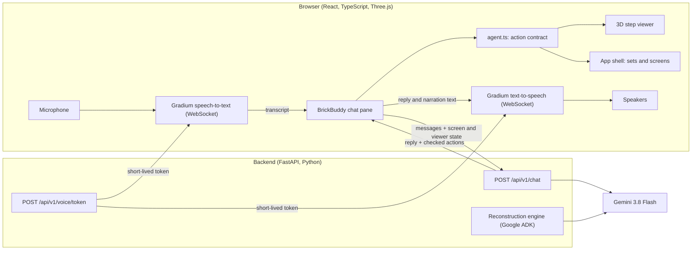

# BrickVisionX

**Talk to your building instructions.** BrickVisionX turns an official LEGO® instruction booklet into an interactive 3D guide, and BrickBuddy, its voice assistant, drives that guide for you while your hands are full of bricks.

Built at the Agentic AI Hack Zürich (Google DeepMind × {Tech: Europe}, 10 October 2026), open innovation track.

> "Show me the plane." → the 3D tutorial opens.
> "I'm stuck at step 5, give me the next three steps." → the model builds itself step by step while BrickBuddy explains which pieces go where.
> "Turn it around." → the model rotates.

## Who it is for

Anyone building from a paper or PDF booklet who gets stuck: children, parents helping them, and adults who find flat 2D diagrams hard to read. Mid-build, both hands are busy and the booklet shows one fixed angle. BrickBuddy lets the builder ask in plain speech, see the step from any side, and hear what to do.

## What it does

| You say or type | BrickBuddy does |
|---|---|
| "Show me the plane" | Finds the set in the catalogue and opens its 3D tutorial |
| "Go to step 5", "next", "back" | Navigates the steps |
| "Walk me through the next 3 steps" | Plays each step's animation and narrates it, one step at a time |
| "Turn it around", "show me the underside", "zoom in" | Moves the camera by the angle asked |
| "Make the plane fly and then explode it" | A showpiece: the model flies, crashes and settles into an exploded view of every piece |
| "Put it back together", "go home" | Restores the model, returns to the start page |

It works by voice (hands-free: it listens, answers, and listens again) or by typing in the chat pane.

## How it meets the brief's four tests

- **It acts.** One spoken sentence becomes a plan of concrete actions that the app carries out: open a set, jump to a step, run a narrated multi-step walkthrough in sync with the animation, move the camera. Several actions can run from one request.
- **It helps someone real.** A builder who is stuck mid-build with their hands full. See "Who it is for".
- **People stay in control.** BrickBuddy can only navigate and animate. It cannot buy, delete, send or change any data, so nothing it does needs undoing. Every action is checked on the server before the browser runs it, paid replies are capped, the microphone is only open when the builder turns it on, and a new request or a tap interrupts it. The 3D models are labelled as unreviewed candidates, and BrickBuddy says so when asked.
- **It works live.** It runs on a laptop with a real microphone, real Gemini calls and real speech. Typing and browser speech are fallbacks if voice is unavailable.

## What was built at the hackathon

The hackathon rules allow boilerplate, so here is the split.

**Existing before the event (boilerplate):** the Guide2Build engine and viewer by a team member (open source, MIT, [lumensparkxy/brickguide-3d](https://github.com/lumensparkxy/brickguide-3d)). It covers official-source download, the reconstruction engine and its checks, the review workflow, the Three.js step viewer, and the authored plane reference used in the demo.

**Built on the day:**
- The engine runtime moved to **Google ADK and the Gemini Developer API** (`apps/api/src/guide2build/engine/`).
- **BrickBuddy**, the assistant: a Gemini-backed chat endpoint that returns a spoken reply plus viewer actions, a shared action contract, and the chat pane.
- **Voice** with Gradium: streaming speech-to-text with end-of-turn detection, streaming text-to-speech, hands-free conversation.
- **Viewer capabilities** the assistant needs: narrated ranged playback, rotation by angle, a camera that keeps its angle across layout changes, and the fly-and-explode showpiece.
- **Safety and cost controls:** server-side action validation, a reply cap, and keys kept on the backend.
- Tests, a CI fix, and a development record in Entire (three trails, two of them with agent reviews).

## Architecture



The browser never holds an API key. For each speech connection it asks the backend for a short-lived Gradium token; the Gemini key is used only on the backend.

More detail: [technical overview](docs/HACKATHON_TECHNICAL.md) and [APIs, frameworks and tools](docs/APIS_AND_TOOLS.md).

## Setup

**Requirements:** Python 3.11 or later with [uv](https://docs.astral.sh/uv/), Node.js 22.12 or later, and Chrome (for the microphone).

```bash
git clone https://github.com/lumensparkxy/brickvisionx.git
cd brickvisionx
uv sync --extra dev --frozen
npm ci
```

**Keys.** Copy `.env.example` to `.env` and fill in:

| Variable | Needed for | Where to get it |
|---|---|---|
| `GOOGLE_API_KEY` | BrickBuddy's chat and the reconstruction engine | [Google AI Studio](https://aistudio.google.com/app/apikey) |
| `GRADIUM_API_KEY` | Voice in and out | [Gradium](https://docs.gradium.ai) |
| `GRADIUM_VOICE_ID` (optional) | A different voice; defaults to "Emma" | Gradium voice library |

Keep `GOOGLE_GENAI_USE_VERTEXAI=FALSE`. `.env` is gitignored; never put keys in `VITE_*` variables or commit them. Without a Gradium key the chat still works by typing, with the browser's built-in speech.

**Prepare the demo model** (once per clone). This downloads the official booklet for set 30669 and the individual LDraw parts it uses, and builds the labelled plane candidate into the ignored `var/` folder:

```bash
uv run python tools/prepare_reference.py
```

**Run:**

```bash
uv run python tools/dev.py
```

Open http://127.0.0.1:5173 and click **Just ask**, or **Try the plane tutorial**. The API is at http://127.0.0.1:8000 (health check: `/api/v1/health`).

If port 8000 is taken, start the two servers yourself and point the web server at the API:

```bash
uv run python -m uvicorn guide2build.main:app --app-dir apps/api/src --host 127.0.0.1 --port 8123
```

```bash
GUIDE2BUILD_API_ORIGIN=http://127.0.0.1:8123 npm run dev
```

### Trying it

1. Allow the microphone when Chrome asks, and check that the laptop's sound is on.
2. Tap the mic once. BrickBuddy stays in conversation until you tap it off.
3. Say "show me the plane", then "I'm stuck at step 5, walk me through the next three steps", then "turn it around".

The speaker button in the chat header mutes BrickBuddy's voice. If the microphone is silent, the chat says which input device it heard nothing from.

## Tests

```bash
uv run python tools/check.py
```

This runs the linter, the backend tests, the frontend tests and a production build. All tests are offline: model and voice calls are replaced by synthetic responses, so nothing is billed. The same script and the browser tests run in GitHub Actions on every push.

```bash
npx playwright install chromium
npm run test:e2e -- --project=software
```

## The reconstruction engine

Separate from the live demo, the engine proposes a 3D reconstruction from booklet pages with Google ADK and Gemini, under an explicit request budget per job. Starting the app never calls it.

```bash
uv run python tools/adk_smoke.py
```

sends one verified booklet page through ADK and validates the result. Full engine experiments are explicit commands, described in [docs/execution/ENGINE.md](docs/execution/ENGINE.md); [docs/migration/VALIDATION.md](docs/migration/VALIDATION.md) records what was and was not verified.

## Limits, stated plainly

- **The demo model is an authored reference, not an automatic conversion.** The plane (set 30669, alternate booklet 02) was authored from the official booklet with PDF assistance and is labelled "needs review". No human or physical-build review has been recorded for it.
- **One model in 3D.** The catalogue lists ten sets and nineteen booklets, but only the plane has a 3D scene in this repository. For the others BrickBuddy shows the official booklets and says no 3D tutorial is ready.
- **BrickBuddy plans in one model call per request.** It returns a list of actions that the app executes; it is not a long-running multi-tool agent.
- **Step navigation ignores booklet sections,** so sets whose step numbers restart per section are not handled yet.
- **The showpiece animation is tuned for the plane only.**
- **Voice needs Chrome.** Safari and Firefox are untested.

## Documentation

- [Technical overview for the jury](docs/HACKATHON_TECHNICAL.md): architecture, request flow, API reference, safety controls, testing, development record.
- [APIs, frameworks and tools](docs/APIS_AND_TOOLS.md): everything the project uses, with versions and where it is used.
- [docs/00_START_HERE.md](docs/00_START_HERE.md) and the numbered files beside it: the product, architecture, data contract and API specifications of the underlying engine and viewer.
- [docs/execution/](docs/execution/): engine runbook, plan and progress records.

## Rights and notices

BrickVisionX is an independent project, not affiliated with or endorsed by the LEGO Group. LEGO® is a trademark of the LEGO Group. Official booklets are downloaded from LEGO's own site at setup time and are not redistributed here. Part geometry comes from the [LDraw](https://www.ldraw.org) parts library, one part at a time, with its notices and provenance preserved; no complete community model is used.
