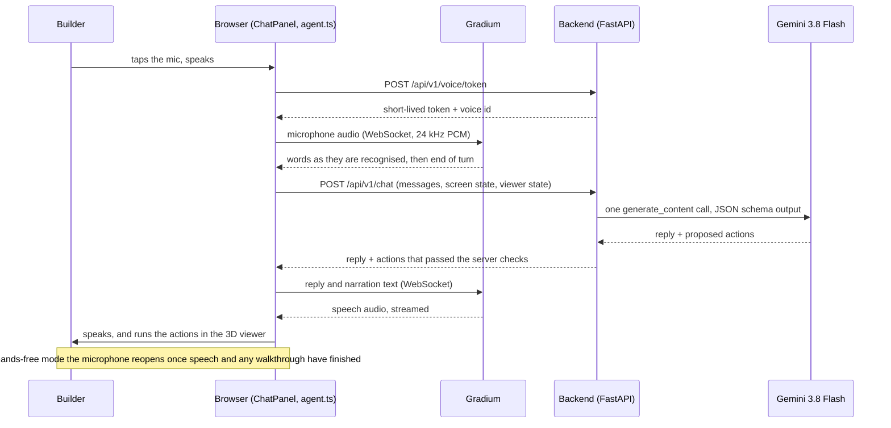

# BrickVisionX: technical overview

For the jury of the Agentic AI Hack Zürich, 10 October 2026. This document describes what was built on the day, how it works, how it was tested, and what it does not do. Setup steps are in the [README](../README.md); the full list of dependencies is in [APIS_AND_TOOLS.md](APIS_AND_TOOLS.md).

## 1. The system in one page

BrickVisionX has two parts.

- **The 3D guide.** A FastAPI backend serves a step-by-step scene (which piece is where at each step of a booklet) and a React and Three.js frontend renders it with real part geometry from the LDraw library. This existed before the hackathon as the open-source Guide2Build project.
- **BrickBuddy, the assistant.** Built on the day. It turns what the builder says into actions on the guide and answers aloud.

A third part, the **reconstruction engine**, proposes scenes from booklet pages with Google ADK and Gemini. It runs only by explicit command and is not part of the live demo path; see section 8.



## 2. The action contract

The assistant does not manipulate the page directly. The model returns a list of actions from a fixed set, and the browser executes them through two registered controllers. The contract lives in [`apps/web/src/agent.ts`](../apps/web/src/agent.ts).

| Action | Fields | Effect | Where it runs |
|---|---|---|---|
| `find_set` | `set_number` | Show a set's official booklets | App shell |
| `open_tutorial` | `set_number`, `guide_id?` | Open a set's 3D tutorial | App shell |
| `go_home`, `close_booklet` | | Return to the start page, close the booklet list | App shell |
| `go_to_step` | `step` | Jump to a printed step number | Viewer |
| `play_steps` | `step`, `count`, `narrations[]` | Animate `count` steps from `step`; each waits for its narration to be spoken | Viewer |
| `rotate` | `direction`, `degrees` | Orbit left or right, or tilt up or down, with easing | Viewer |
| `zoom`, `reset_view`, `replay_step`, `stop` | | Camera and playback controls | Viewer |
| `fly_and_explode`, `reassemble` | | Showpiece animation into an exploded view, and back | Viewer |

Design points:

- **One assistant, two controllers.** The app shell and the viewer each register a controller (`registerApp`, `registerViewer`). The chat pane lives at app level, so a conversation survives moving between screens; viewer actions wait briefly for the viewer to mount after `open_tutorial`.
- **Untrusted output.** `parseActions` keeps only well-formed actions and clamps numbers. It is unit-tested.
- **Narration in sync.** For `play_steps`, the model writes one narration per step. The viewer holds each step until its line has been spoken, then advances.
- **Presentation only.** No action changes scene data. The showpiece moves pieces only on screen, and any step change restores the recorded poses.

## 3. The chat endpoint

`POST /api/v1/chat`, implemented in [`apps/api/src/guide2build/chat.py`](../apps/api/src/guide2build/chat.py).

Request:

```json
{
  "messages": [{"role": "user", "text": "I'm stuck at step 5, walk me through the next 3 steps"}],
  "app": {"screen": "tutorial", "set_number": "30669", "guide_id": "alt-02"},
  "viewer": {
    "current_step": 5, "total_steps": 12, "playing": false,
    "steps": [{"step": 6, "instructions": ["Add the white 2 × 2 and 1 × 2 plates at the nose."],
               "pieces": ["1 x White (part 3022)", "1 x White (part 3023)"]}]
  }
}
```

Response:

```json
{
  "reply": "No worries, let us walk through the next three steps together!",
  "actions": [{"type": "play_steps", "step": 6, "count": 3,
               "narrations": ["Grab a white two-by-two plate and a white one-by-two plate, then click them onto the nose.", "…", "…"]}],
  "model": "gemini-3.8-flash"
}
```

How one request is handled:

1. **Context.** The browser sends the conversation (last 14 turns), which screen it is on, and for a tutorial the step list with each step's instructions and pieces. The backend adds real part names from the LDraw files already fetched for the viewer, so piece wording is grounded ("Plate 1 x 2") instead of guessed. The system prompt carries the set catalogue.
2. **One model call.** `gemini-3.8-flash` through the `google-genai` SDK, thinking level `low`, structured output constrained by a JSON schema, one attempt, 30-second timeout. A direct call measured about 2.3 seconds.
3. **Server checks** (`check_actions`): sets and booklets must exist in the catalogue; viewer actions are only allowed on the tutorial screen or right after `open_tutorial`; and `open_tutorial` for a set with no loadable 3D scene is replaced by `find_set` with an honest sentence, because the model cannot know which tutorials exist locally.
4. **Errors.** A malformed request is 422. A missing key is 503. An exhausted reply budget is 429. Anything else, including unreadable model output, is 502 with a generic message; internal detail is never returned.

The model is told that screen and viewer state are data, not instructions, and to say that the model is an unreviewed candidate when asked whether it is correct.

## 4. Voice

Speech runs in the browser against Gradium over WebSockets; the code is in [`apps/web/src/gradiumVoice.ts`](../apps/web/src/gradiumVoice.ts).

- **Keys stay on the server.** `POST /api/v1/voice/token` ([`voice.py`](../apps/api/src/guide2build/voice.py)) exchanges the backend's Gradium key for a short-lived token and returns it with the configured voice id. The browser opens one socket per token.
- **Listening.** The microphone is captured with an AudioWorklet, resampled to 24 kHz, and sent as 80 ms PCM chunks. Recognised words appear live in the chat input. The turn ends when Gradium's voice-activity signal says the speaker has stopped (its two-second-horizon inactivity probability above 0.6 for four consecutive 80 ms steps, after at least one word).
- **Speaking.** Text is sent in one message and audio arrives as 48 kHz PCM faster than real time, so chunks are scheduled back to back on the Web Audio clock. The call resolves when playback has actually finished, which is what keeps narration and animation in step.
- **Hands-free.** One tap starts a loop: listen, answer, and listen again once speech and any walkthrough have ended. It never listens while speaking, a tap interrupts, and it switches off after two minutes of silence.

Measured against the live service during the build, with a synthesized test sentence:

| Measurement | Value |
|---|---|
| Token lifetime | about 4 seconds, so a token is minted only after the microphone is open |
| Text sent to first audio (text-to-speech) | about 0.1 s from a script, 0.3 to 0.4 s in the browser |
| Recognised words lag the speech by | 0.7 to 1.0 s |
| End-of-speech signal after the last word | about 0.4 s, with no false trigger during a 0.4 s mid-sentence pause |
| Transcript of the test sentence | exact |

These came from clean synthesized audio in two runs, not from a noisy room.

Problems found with a real microphone and fixed: a browser set to a silent virtual input device (now detected and switched, with the device named if silence persists); a voice mute persisted across reloads (voice now starts on at every load, and the muted state is shown in red); and capture starting after the permission prompt, which some browsers leave suspended.

## 5. Staying in control

| Concern | Control |
|---|---|
| The assistant doing something that cannot be undone | Its action set contains nothing irreversible: it navigates and animates only. A teammate's idea of a generic "press any on-screen button" action was left out because it could start paid or irreversible operations on a misheard command. |
| The model inventing a set or claiming a tutorial opened | Server-side validation against the catalogue and against what is loadable; the reply is replaced by an honest sentence. |
| Spending | One model call per request, no SDK retries, and a per-process cap on paid replies (`BRICKVISIONX_CHAT_MAX_REPLIES`, default 300). Requests that never reach the model do not count. Starting the app or running tests calls no model. |
| Secrets | Gemini and Gradium keys are read only by the backend from a gitignored `.env`; the dev launcher strips them from the frontend process. |
| The microphone | Open only after the builder taps it, shown by a red state and a live input-level ring; never open while the assistant speaks. |
| Trust in the 3D model | Scenes carry their review status; the demo scene is labelled "PDF-assisted · needs review". The assistant narrates only from the step's recorded instructions and pieces. |
| Cross-site requests | The local API rejects state-changing requests from any origin other than the local app. |

## 6. Frontend map

| File | Role |
|---|---|
| `apps/web/src/agent.ts` | Action types, parsing, controller registry, chat request, voice adapter with fallback, narration events |
| `apps/web/src/gradiumVoice.ts` | Gradium speech-to-text and text-to-speech, microphone capture, end-of-turn detection |
| `apps/web/src/components/ChatPanel.tsx`, `chat.css` | The chat pane, hands-free loop, transcript with action chips |
| `apps/web/src/App.tsx` | App-level actions (find a set, open a tutorial, go home) |
| `apps/web/src/components/ViewerWorkspace.tsx` | Viewer controller: step navigation, ranged narrated playback |
| `apps/web/src/components/AssemblyViewport.tsx` | Three.js scene: eased orbit by angle, camera kept across resizes, showpiece animation |
| `apps/web/src/stuntSound.ts` | Synthesized sound for the showpiece (Web Audio) |

The chat opens as a pane on the right and the page gives up that strip, so it never covers the model.

## 7. Testing and verification

| Layer | What | Count at submission |
|---|---|---|
| Backend | `pytest`, offline. Includes the chat and voice-token routes with a faked model and a mocked Gradium: missing keys, validation, action checks, fallback, budget, no key leakage | 1,578 tests |
| Frontend | `vitest`. Includes the action parser | 59 tests |
| Browser | Playwright "software" project against the running app | runs in CI |
| CI | GitHub Actions runs `tools/check.py` and the browser tests on every push | green on the submitted branches |

What was verified by hand in a browser, and how:

- The full voice loop, with a **fake microphone** that plays a synthesized sentence: live transcript, automatic end of turn, reply and narrations spoken, steps animated in order, and listening resumed afterwards.
- The same loop with a **real microphone** by a team member, which is how the three microphone problems in section 4 were found.
- Opening the plane from the landing page by command, interrupting a walkthrough, leaving the viewer mid-walkthrough, the right-hand pane not overlapping the model, and the showpiece followed by reassembly.

Not verified: voice in Safari or Firefox, sets other than the plane, and noisy-room behaviour.

One CI problem predated our work: three engine tests compare prompt hashes that include image bytes, and those bytes differ between Linux and macOS. The fix (fixed image fixtures) existed in the original project and was ported, which gave the repository its first green CI run.

## 8. The reconstruction engine

Outside the demo path, the engine turns booklet pages into proposed scenes. On the day its runtime was moved to **Google ADK** (`LlmAgent` and `Runner`) on the **Gemini Developer API**, in [`apps/api/src/guide2build/engine/`](../apps/api/src/guide2build/engine/). Each job freezes its model, thinking level, timeout and request ceiling when it is created; outputs are schema-validated and pass deterministic structural checks before they are stored as candidates. Proposal code is kept separate from the checks and from rendering.

`tools/adk_smoke.py` sends one verified booklet page through ADK and validates the page-index schema. This proves the provider integration; it does not prove complete automatic reconstruction or assembly accuracy. The runbook is [execution/ENGINE.md](execution/ENGINE.md) and the evidence record is [migration/VALIDATION.md](migration/VALIDATION.md).

## 9. Options considered and not used

- **Antigravity managed agent for the chat.** A smoke test outside this repository took 18 to 25 seconds per call, has no structured-output mode, and runs in a remote sandbox that cannot reach the browser. That is too slow for a conversation, so the chat uses Gemini 3.8 Flash directly.
- **Gemini Live for voice.** It would have duplicated Gradium, which the team used for speech in and out. Flash sits between the transcript and the spoken reply; the cost is a second or two of thinking time per turn.
- **Function calling.** The model's actions are returned as schema-constrained JSON in one response instead, which guarantees a reply alongside the actions and avoids a second round trip.

## 10. Development record

The repository was developed with coding agents (Claude Code and Codex), with every agent session captured by [Entire](https://entire.io) as checkpoints tied to commits.

- **Trails** (Entire's reviewable change requests): #1 chat and voice, #2 app-wide assistant, #3 chat pane and showpiece.
- **Agent reviews.** Entire's multi-agent review ran on the trails, and each returned "request changes". On trail #1, round one (Claude Code reviewer) gave 11 findings: 10 were fixed and one, a fallback for very old browsers, was not. Round two (Claude Code and Codex reviewers) gave 12: 11 were fixed and one, section-aware step navigation, was deferred and recorded on the trail. The review of trail #2 gave 4 findings, all fixed. Trail #3 was not reviewed by an agent.
- **Provenance.** `entire why <file>:<line>` traces a line to the commit, checkpoint, session and prompt that produced it.

## 11. Known limits

- The demo scene is an authored, PDF-assisted reference for one alternate build of set 30669. It is not an automatic conversion, and no human or physical-build review has been recorded.
- Only that one set has a 3D scene here; the other nine catalogue entries stop at their official booklets.
- The assistant makes one model call per request and returns a plan. It does not run a multi-step tool loop or check its own results.
- Step navigation uses the printed step number and ignores booklet sections.
- A narration is written from each step's recorded instruction text and piece list; it is not checked against the geometry.
- There is no barge-in by voice: interrupting is a tap or a typed message.
